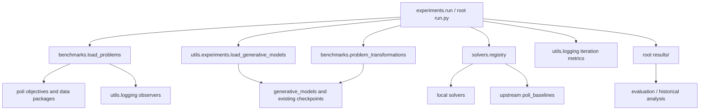

# Repository architecture

Phase 1 organizes existing research code without changing optimization behavior.
The Python distribution and package remain `hdbo_benchmark` (version 1.0.0), using
the existing `src/` layout. There is no new solver interface or experiment runner.

```text
ROTLSC/
  AGENTS.md, README.md
  pyproject.toml, setup.cfg, requirements*.txt, tox.ini
  environment*.yml, envs/       existing environment definitions
  configs/README.md            index of actual configuration locations
  src/
    cowboys*.py, run.py        installed legacy module aliases
    hdbo_benchmark/
      solvers/                five local methods and registry
      benchmarks/             poli loaders and representation transformations
      generative_models/      VAE, AE, one-hot and diffusion components
      experiments/            current CLI plus historical/training protocols
      evaluation/             current local tables and iteration plots
      results/                historical paper/website analysis source
      utils/                  retained shared and domain utilities
      data_preprocessing/     existing ordered Zinc conversion scripts
      assets/                 packaged metadata and checkpoints
      sanity_checks/          existing BO demonstration
  scripts/experiments/         existing shell sweeps
  tests/                      structural and existing integration tests
  docs/                       audit, architecture, migration evidence, future work
  data/                       existing datasets/checkpoints/PDBs/embeddings
  results/                    generated optimization outputs (ignored)
  reports/                    figures and legacy analysis entry points
  logs/, wandb/, oracle/       existing local runtime artifacts
  run.py, cowboys*.py          checkout compatibility aliases
  run*.sh                     checkout compatibility launchers
  batch.sh, batch_gpu.sh       unchanged SLURM entry points
```

The root aliases are deliberate compatibility boundaries, not duplicate algorithm
implementations. There are no empty method/config/notebook placeholder folders.

## Methods and scientific components

| Solver key | Canonical implementation | Components kept together |
|---|---|---|
| `cowboys` | `solvers/cowboys.py:COWBOYS` | GP/fingerprints, acquisition, MCMC proposals, diagnostics |
| `cowboys_flow` | `solvers/cowboys_flow.py:COWBOYSFlow` | Flow layers, weighted proposal, mixture, GP and diagnostics |
| `cowboys_flow_2` | `solvers/cowboys_flow_2.py:COWBOYSFlow` | Separate flow variant and proposal diagnostics |
| `cowboys_diffusion` | `solvers/cowboys_diffusion.py:COWBOYSDiffusion` | Diffusion sampling/guidance, critic, GP and acquisition |
| `lsbo` | `solvers/latent_space_bo.py:LatentSpaceBayesianOptimization` | Latent-space GP/EI and acquisition optimization |

`solvers/registry.py` retains all existing solver names, environment mapping and
constructor settings. Directed evolution, hill climbing, genetic algorithm,
CMA-ES, random/coordinate LineBO, BAxUS, TuRBO, Hvarfner BO, ALEBO, Bounce, PR,
SAASBO and LaMBO2 are integrations with upstream `poli_baselines`, not new local
implementations. The factory also has `vanilla_bo` and
`vanilla_bo_with_lognormal_prior` branches absent from `SOLVER_NAMES`; that
pre-existing inconsistency is retained. `utils/ax/` and
`utils/latent_space_solver.py` retain older adapters.

The plotting aliases `dgbo` and `nflow3` refer to `cowboys_diffusion` and
`cowboys_flow_2`, respectively; they are not additional local implementations.

GP fitting and acquisition remain inside methods where they already lived.
`utils/experiments/training_gps.py` is the existing shared exact-GP helper;
normalization remains in `utils/experiments/normalization.py`. A separate
`models/` or `acquisition/` package would require internal extraction and is
deferred. The two flow files intentionally remain distinct.

`generative_models/` contains molecular/Mario VAEs, an RNN VAE, the historical
`vae_selfies-old.py`, protein autoencoder/ESM support, one-hot representation,
latent diffusion and its dataset/cache helpers. Factories choose existing
checkpoints. Flow proposal models remain local to their solver files.

## Evaluation and execution dependencies



The current CLI loads a poli problem and its initial supervised data, attaches
the existing evaluation budget/observer, optionally loads the representation
model and transforms the black box to continuous space, then constructs the
selected solver. It attaches the existing VAE/bounds and diffusion checkpoint
when supported. It calls `step()` with periodic saves where available, otherwise
uses the existing `solve()` branch. This sequence and exception handling are
unchanged.

PMO uses SELFIES and ten initial molecules in the existing loader. Other loader
branches cover `rfp_rasp`, `rfp_foldx_stability`, Ehrlich tiny/small/large and
`pest_control_equivalent`. Initialization counts and objective conventions stay
in the loader, not in a new config layer. The default CLI function string remains
`foldx_stability`, which does not match that loader key; it is documented debt.

Run from the repository root after an editable install:

```bash
python run.py --help
python -m hdbo_benchmark.experiments.run --help
python -m hdbo_benchmark.evaluation.plot_iteration_metrics --help
```

These two experiment CLI forms execute the same implementation. Existing
benchmark-specific `run.py`, compiler and batch files remain in `experiments/`;
they are independent historical protocols and may rely on older poli APIs.
Training entry points remain present and must not be run as structural checks.

## Storage and paths

The current runner uses the working-directory-relative output root:

- Non-diffusion: `results/new_vae_10_chain_100_steps_with_stoch_sampling_<sufix>/`.
- Diffusion: `results/diffusion/<existing parameter-derived directory>/`.
- Filenames include `<solver_name>_<function_name>_<seed>` with `.npy`,
  `_history.npz`, `_iteration_results.json` and `_status.json`, according to the
  existing saving branches. Some diagnostics may evaluate candidate objectives;
  this behavior has not been changed or scientifically reviewed.

The current plotting CLI reads root `results/` and writes
`reports/iteration_plots/` by default. The table module keeps its hardcoded
selection and import-time reporting behavior. Historical runners/analysis may
use `data/benchmark_on_*`, W&B, `data/results_cache/`, package `results/` source,
or `reports/figures/`. These formats were not unified.

`utils/constants.py` still computes repository paths from its existing depth.
Some other modules independently do the same. Molecular VAE lookup still checks
`data/trained_models/training_vae_on_zinc_250k` before package assets; checkpoint
precedence and bytes are unchanged. Data loaders, preprocessing modules and
resource files were not relocated. Wheels can contain packaged assets, but
repository-relative external data remains a limitation for standalone installs.

## Compatibility and import boundaries

- Root COWBOYS modules, `run`, and old loader/transform module paths alias the
  canonical module in `sys.modules`, preserving private helpers and shared module
  state. New internal references use canonical imports.
- `src/cowboys*.py` and `src/run.py`, declared in `setup.cfg`, provide the same
  aliases in installed distributions. Root copies serve checkout entry points.
- Old report script paths and the explicit root integration-test path remain
  usable. Pytest defaults to `tests/` to avoid duplicate collection.
- Root `run*.sh` forwards to unchanged script bodies in `scripts/experiments/`.
  Working-directory assumptions, environment variables and exit status remain.
- `solvers` lazily resolves its two existing exported classes. Importing package
  namespaces does not load PyTorch/poli/plotting. Importing an actual solver still
  needs its original scientific dependencies; broad generative-model imports
  and legacy import-time side effects are not rewritten.
- Legacy pickle class references can resolve through aliases. New serialized
  classes use canonical package names; arbitrary old object payloads and external
  scripts depending on `__file__` have not been exhaustively tested.

See [verification](MIGRATION_VERIFICATION.md) for tested boundaries and known
environment/build limitations. Add future methods to `solvers/` and register
them explicitly after a separately scoped scientific change. Add benchmark
adapters under `benchmarks/`, current analysis under `evaluation/`, and preserve
historical protocols unless their migration is explicitly in scope.
